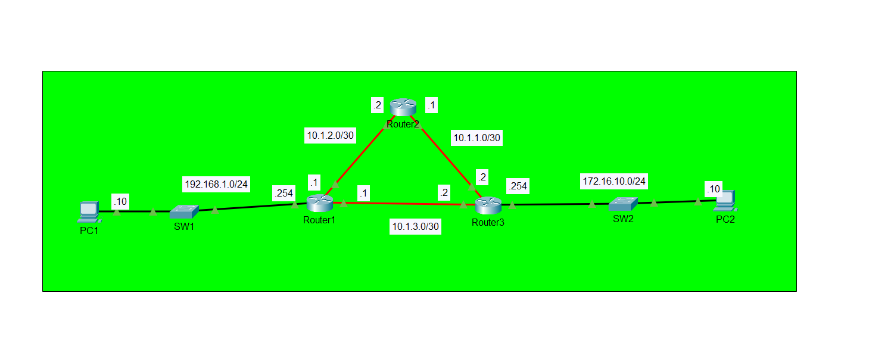

# EIGRP en Cisco \| Configuración y verificación

## 📘 Descripción del proyecto

Aprende los fundamentos de EIGRP (Enhanced Interior Gateway Routing
Protocol), configura el enrutamiento dinámico entre routers Cisco y
verifica el intercambio de rutas y la conectividad de la red.

🔗 **Video del laboratorio:**\
🎥 [EIGRP en Cisco \| Configuración y
laboratorio](https://youtu.be/kDW1VAeXzJ0)

------------------------------------------------------------------------

## 🎯 Objetivos del proyecto

1.  **Comprender los conceptos clave de EIGRP y su funcionamiento como
    protocolo de enrutamiento dinámico.**
2.  **Configurar EIGRP en routers Cisco y anunciar las redes
    correspondientes.**
3.  **Verificar las adyacencias, la tabla de vecinos y las rutas
    aprendidas.**
4.  **Probar la conectividad entre dispositivos y validar el
    funcionamiento del enrutamiento.**

------------------------------------------------------------------------

## 🧰 Tecnologías y herramientas utilizadas

Cisco Packet Tracer 8.x; Routers Cisco; EIGRP; Enrutamiento dinámico;
IPv4

------------------------------------------------------------------------

## 📂 Estructura del repositorio

EIGRP en Cisco/

├── EIGRP-Cisco.pkt ← Archivo del laboratorio (abrir con Packet Tracer)

├── EIGRP-Cisco.png ← Imagen de la topología del proyecto

└── README.md ← Documentación del laboratorio

------------------------------------------------------------------------

## 🚀 Cómo usarlo

1.  Descarga el archivo `.pkt` desde esta carpeta.
2.  Ábrelo con **Cisco Packet Tracer 8.x o superior**.
3.  Revisa la topología y las configuraciones de EIGRP.
4.  Ejecuta pruebas (`ping`, `show ip route`, `show ip eigrp neighbors`,
    etc.) para validar el funcionamiento de la red.

------------------------------------------------------------------------

## 🌐 Topología visual

------------------------------------------------------------------------

## 📝 Notas adicionales

🌐 Mis redes y recursos:

🌲 Linktree: https://linktr.ee/SoyWilliamsnet

🌀 Discord (comunidad de redes): https://discord.gg/u2uKQJS4jM

💻 GitHub: https://github.com/SoyWilliamsNet

💡 Substack: https://substack.com/@soywilliamsnet

------------------------------------------------------------------------
